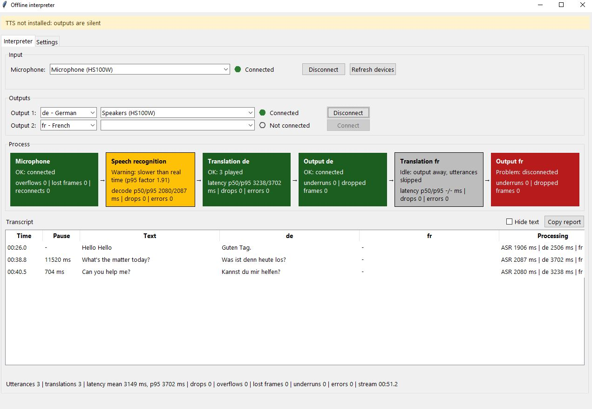
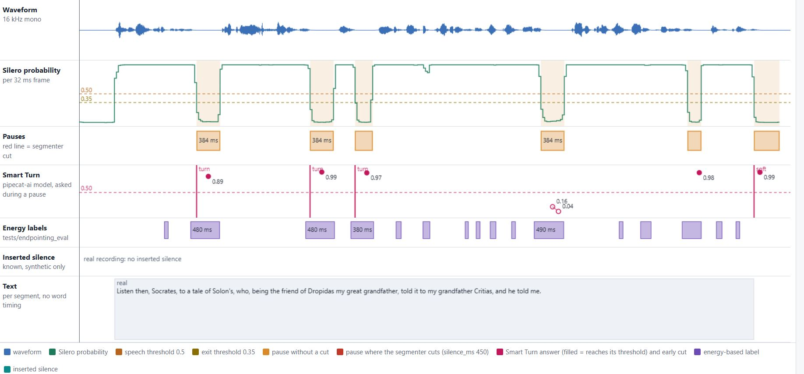

# Offline Real-Time Interpreter (demo)

A strictly offline, privacy-first speech interpretation pipeline for Windows.
One speaker talks into one microphone in one source language; listeners hear
the translation in their own language on their own output device. Nothing is
written to disk and nothing leaves the machine.

```text
microphone (WASAPI) -> resample 16 kHz mono -> Silero VAD -> Segmenter (+ Smart Turn, optional)
      -> ChunkBus -> faster-whisper (once per utterance) -> TextBus
           -> lane de: CTranslate2 -> SAPI TTS -> output A (e.g. HS100W headset)
           -> lane fr: CTranslate2 -> SAPI TTS -> output B (e.g. Realtek speakers)
metrics / dashboard / guards observe every stage (RAM only)
```

> Status: the pipeline runs end to end from a live microphone. Capture, VAD,
> segmentation, whisper, translation and playback work; the control window
> shows the live report and transcript. Known gaps are listed in
> [What works today](#what-works-today).

## How the application works

### Runtime model

The audio callback only copies samples into a preallocated ring buffer.
Whisper, translation, TTS and playback each run in their own thread behind
non-blocking buses (`ChunkBus`, `TextBus`: one bounded queue per subscriber,
drop-oldest policy, per-subscriber stats). Heavy work can therefore never
cause an input overflow — the worst a slow stage can do is drop its own
oldest items. Threads, not processes: NumPy, onnxruntime and CTranslate2
release the GIL. Time is the stream sample counter, not the wall clock, so
measurements do not depend on machine speed.

### Stage by stage

1. **Capture** (`capture.py`). A WASAPI callback stream reads the microphone
   into a ring buffer; a worker resamples to 16 kHz mono and publishes
   immutable chunks. A watchdog reconnects the device when no callback
   arrives for 500 ms.
2. **VAD + segmentation** (`vad.py`). Silero VAD scores every 32 ms frame
   (512 samples); the `Segmenter` state machine turns the probabilities into
   utterance chunks. Details and measurements: [VAD and endpointing](#vad-and-endpointing).
3. **Transcription** (`transcribe.py`). faster-whisper runs **once per
   utterance** (int8, greedy, English models `tiny.en`/`base.en`, selectable).
   A glossary of hotwords biases decoding toward domain terms; very quiet or
   repetitive audio is filtered.
4. **Translation lanes** (`lanes.py`, `translate.py`). One lane per target
   language; each owns a CTranslate2 translator, TTS, resampler, output stream
   and buffer. Lanes share nothing: one failing or slow lane never affects
   another, and a lane more than two utterances behind drops the oldest.
5. **Output** (`tts_sapi.py`, `output.py`). Per-lane Windows SAPI speech on
   the lane's own WASAPI output device, with underrun and drop counters.
6. **Control window** (`ui/`). Tk (standard library; a local web server would
   break the zero-network proof). The *Interpreter* tab has device pickers,
   the live stage tiles, and the transcript with per-utterance pause and
   processing columns. The *Settings* tab exposes every segmenter,
   transcribe, translate and output setting; applying one that needs a restart
   rebuilds the pipeline. *Copy report* puts the full metrics report on the
   clipboard. The window runs in the main thread; slow control calls run on a
   worker and report back through a queue.

### What a session looks like (measured run, 2026-11-08)



Machine: AMD Ryzen 5 2400G (4 cores / 8 threads, Zen 1), Windows 10, other
applications running — absolute numbers are pessimistic. English speech into a
USB headset, one German lane on the same headset, `base.en`, 51 s stream,
3 utterances:

| Metric | Measured |
| --- | --- |
| Input overflows / lost frames / reconnects | 0 / 0 / 0 |
| ASR decode per utterance, p50 / p95 | 2080 / 2087 ms (real-time factor p95 1.91 — the dashboard warns "slower than real time") |
| Translation de per utterance, p50 / p95 | 3238 / 3702 ms |
| End of speech -> first translated audio, mean / p95 | 3149 / 3702 ms |
| Output underruns / drops | 0 / 0 |

Interpretation: on this CPU one whisper pass per utterance is the bottleneck
(measured alone: `tiny.en` median 1.1 s, `base.en` median 1.7-2.3 s per
utterance — [SPEC-LOW-LATENCY.md](docs/SPEC-LOW-LATENCY.md) § 12.4), so the
end-to-end target of <= 1.5 s is not met yet. The levers are a smaller/faster
model, shorter encoder context, or a faster machine.

### What works today

- Microphone connect/disconnect/switch, output connect per language lane,
  live stage tiles with health words (OK / warning / problem), transcript with
  pause and processing columns, copy report.
- End-to-end speech -> text -> translation for a connected output; a lane
  whose output is away idles and skips utterances (visible in the tile).
- Every segmentation setting is changeable at runtime from the Settings tab.

Known gaps:

- **Outputs are silent**: the window still wires the placeholder
  `SilentTtsEngine` instead of `tts_sapi.sapi_tts_factory` (work-plan step 11
  wiring), hence the banner "TTS not installed: outputs are silent".
- `python -B -m pipeline run` / `soak` CLI commands and the 60-minute soak
  run are still to be written.
- Smart Turn is implemented but measured slow on this CPU, so `turn_mode`
  defaults to `fixed` (see below).

## VAD and endpointing

**How a pause ends a chunk.** Silero VAD gives a speech probability per
32 ms frame (cost: 0.44 ms p50 per frame, 0.81 ms p95 — negligible). The
segmenter applies two thresholds with hysteresis:

| Rule | Default | Meaning |
| --- | --- | --- |
| `speech_threshold` | 0.50 | at or above: the frame is speech |
| `exit_threshold` | 0.35 | below: the frame starts/extends the silence clock |
| `silence_ms` | 450 (allowed 450-600) | pause length that ends the chunk |
| `min_speech_ms` | 160 | shorter speech is noise and is dropped |
| `pre_roll_ms` / `tail_ms` | 100 / 160 | audio kept before/after the speech |
| `max_utterance_ms` | 15 000 | forced cut, placed on the quietest frame of the last 1.5 s |

**Smart Turn (optional).** During a pause, after `turn_check_ms` (200 ms) the
last 8 s of audio are scored by the pipecat-ai smart-turn v3.2 model (fp32
ONNX, 32 MB): "has the speaker finished the sentence?" A probability at or
above `turn_threshold` (0.5) ends the chunk early; otherwise the model is
asked again every 96 ms (at most 4 checks per silence run, the first one must
start 200 ms before the fixed fallback). A premature cut is rescued: the cut
audio returns to the open chunk, so no audio is lost or translated twice. For
long speech (`soft_cut_ms` 6000) a shorter 128 ms pause with a stricter
threshold (0.7) ends the chunk ("soft cut").

On this Zen 1 CPU one model check costs ~120-300 ms (fp32, 1-4 threads;
[SMART-TURN-MODEL-COMPARISON.md](docs/SMART-TURN-MODEL-COMPARISON.md)), while
the window between a reliable check and the fixed rule is 160-256 ms — so
`turn_mode` defaults to `fixed` and smart mode is opt-in from the Settings
tab.

**Measured on real speech** (`scripts/eval_endpointing.py`, LibriSpeech
clips, 300 phrase ends and 183 mid-speech segments; precision = cuts that
land on a phrase end, recall = phrase ends that got a cut, premature = cuts
inside continuous speech, latency = decision time after the phrase end):

| Configuration | Precision | Recall | Premature cuts | Latency p50 / p95 |
| --- | --- | --- | --- | --- |
| fixed 450 ms (default) | 52% | 49% | 40% | 554 / 646 ms |
| fixed 525 ms | 55% | 46% | 33% | 618 / 712 ms |
| fixed 600 ms | 58% | 42% | 22% | 675 / 774 ms |
| smart 450 ms | 53% | 52% | 40% | 540 / 626 ms |
| smart 600 ms, check 300 ms | 60% | 49% | 27% | 636 / 738 ms |
| smart 600 ms, check 150 ms | 56% | 51% | 31% | 499 / 720 ms |

Longer silence trades recall for fewer premature cuts; smart mode cuts a bit
earlier and recovers some recall at the same `silence_ms`. Full data:
`data/endpointing_results.json` (13 configurations with 95% CIs).

**Pause viewer.** An offline page shows, per clip, aligned tracks: the
waveform, the Silero probability with both thresholds, the pauses found and
which of them the segmenter cuts, what Smart Turn answers during each pause
and where it would cut early, the energy-based reference labels, the inserted
silence (synthetic streams only) and the text — plus a comparison table of
fixed vs smart over all clips.



- Open: [data/pause_viewer.html](data/pause_viewer.html) in a browser. The
  page is generated on your machine and is not committed: `data/` is ignored
  and the page embeds LibriSpeech audio (~5.6 MB).
- Build: `python -B scripts/pause_viewer.py` (needs `models/` and `data/`
  from `scripts/fetch_models.py --with-data`). Source:
  [scripts/pause_viewer.py](scripts/pause_viewer.py).

## Guarantees

| Guarantee | How it is enforced |
| --- | --- |
| No network at runtime | `pytest --disable-socket`; `--strict` audit hook blocks `socket.connect`; OS check with `Get-NetTCPConnection` in Airplane Mode |
| No disk writes at runtime | Audit-hook fixture in tests; `--strict` mode in the app; Process Monitor capture during the soak run |
| Permissive licenses only | `pip-licenses --allow-only` in CI (MIT, Apache-2.0, BSD, PSF, ISC) |
| Zero input overflows | 60-minute soak run under CPU load, report in this README (pending, see gaps above) |
| Low latency | Per-stage and per-lane latency on the dashboard; target <= 1.5 s from end of speech to start of translation (not met on this CPU yet, see measured run) |

## Requirements

- Windows 10/11 x64, Python 3.11 or 3.12, CPU only.
- A USB microphone (any WASAPI capture device).
- One output device per target language.
- Windows SAPI voices installed for each target language
  (Settings -> Time & Language -> Speech).
- For tests only: [VB-Audio Virtual Cable](https://vb-audio.com/Cable/) (A+B).

## Quick start

```powershell
python -m venv .venv
.venv\Scripts\activate
pip install -e ".[dev]"
python scripts/fetch_models.py            # the only step that uses the network
python -B -m pipeline list-devices
python -B -m pipeline gui                 # control window: devices, languages, settings, live report
```

`gui` starts even with no device chosen; devices and languages are picked in
the window. Until the TTS wiring gap (see above) is closed it plays silence
and shows the banner "TTS not installed: outputs are silent". The `run` and
`soak` commands are still to be written.

## Development

```powershell
python -B -m pytest -m "unit or model" --disable-socket   # fast, no hardware
python -B -m pytest -m virtual --disable-socket           # needs VB-Cable
ruff format --check . ; ruff check . ; mypy --strict src
python scripts/check_no_cyrillic.py                       # English-only rule
```

Rules for contributors and AI agents live in [CLAUDE.md](CLAUDE.md).
Project agents are in `.claude/agents/`, project skills in `.claude/skills/`.
Specifications: [docs/SPEC.md](docs/SPEC.md) (base),
[docs/SPEC-LOW-LATENCY.md](docs/SPEC-LOW-LATENCY.md) (latency extension),
[docs/SMART-TURN-MODEL-COMPARISON.md](docs/SMART-TURN-MODEL-COMPARISON.md).

## License

MIT — see [LICENSE](LICENSE).
